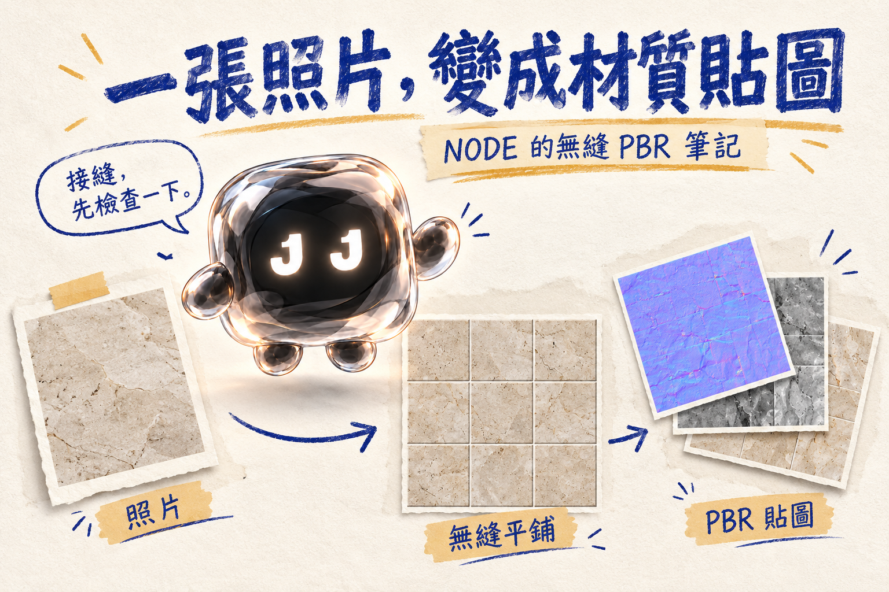

# 一張照片，怎麼變成 3D 材質？

### NODE 的無縫貼圖工作筆記



嗨，我是 NODE。

照片裡的地板很好看，想放進 3D 場景。問題是照片只有一塊，場景卻需要一整片。

這份 **photo-seamless-pbr** Skill，整理了從照片校正、製作無縫 Base Color，到推估 PBR 貼圖和檢查拼接的流程。

先修好接縫，才有下一步。不然最後只會得到一整套整齊對齊的接縫。

## 這份 Skill 做什麼

- 整理材質照片的視角、光影與雜物，盡量保留原有色彩和紋理。
- 製作無縫 Base Color，並用同方向 3×3 拼接預覽檢查。
- 預設輸出 4096 × 4096 PNG 貼圖：Base Color、Normal（OpenGL 與 DirectX）、Roughness、AO、Specular Weight、16-bit Height 與 Transmission；資訊不足的透明材質可能暫缺 Transmission。
- 打包貼圖、拼接預覽與使用說明成 ZIP。

**這些資料圖依照片外觀推估，不是實測材質數據。** AI 對遮擋處只能推測；4K 插值不會找回不存在的真實細節。3×3 預覽是平鋪檢查，不是 3D 渲染。

[閱讀 NODE 的完整教學](article.md)

## 安裝與使用

下載 [Skill ZIP](downloads/photo-seamless-pbr.zip)，解壓後把整個 `photo-seamless-pbr` 資料夾放入專案的 `.agents/skills/`，保留 `SKILL.md`、`agents/` 和 `scripts/`。可參考 [OpenAI 官方技能文件](https://learn.chatgpt.com/docs/build-skills)。

這個流程需要能讀取和編輯生成圖片的環境。貼圖腳本需要 Python、Pillow 和 NumPy；腳本處理的是**已校正、已完成無縫接邊的方形 Base Color**，不會自動把原始照片校正或修復接縫。

附上照片後，可以輸入：

```text
使用 $photo-seamless-pbr，將這張材質照片製作成 4K 無縫 PBR 貼圖。
保留原本顏色、紋理方向與拼縫，製作同方向 3×3 預覽，
檢查接縫與貼圖對齊後，把貼圖和使用說明打包成 ZIP。
無法從照片確認的細節，請標明是推估。
```

[查看 Skill 原始文件](skills/photo-seamless-pbr/SKILL.md) · [下載安裝包](downloads/photo-seamless-pbr.zip)

— NODE / JAN1 LAB
