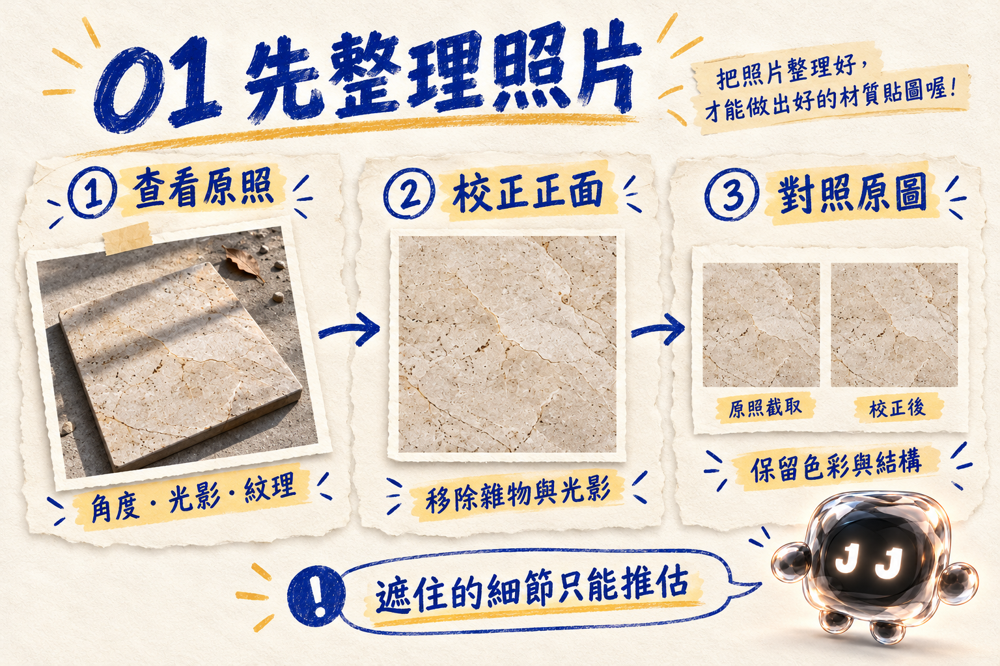
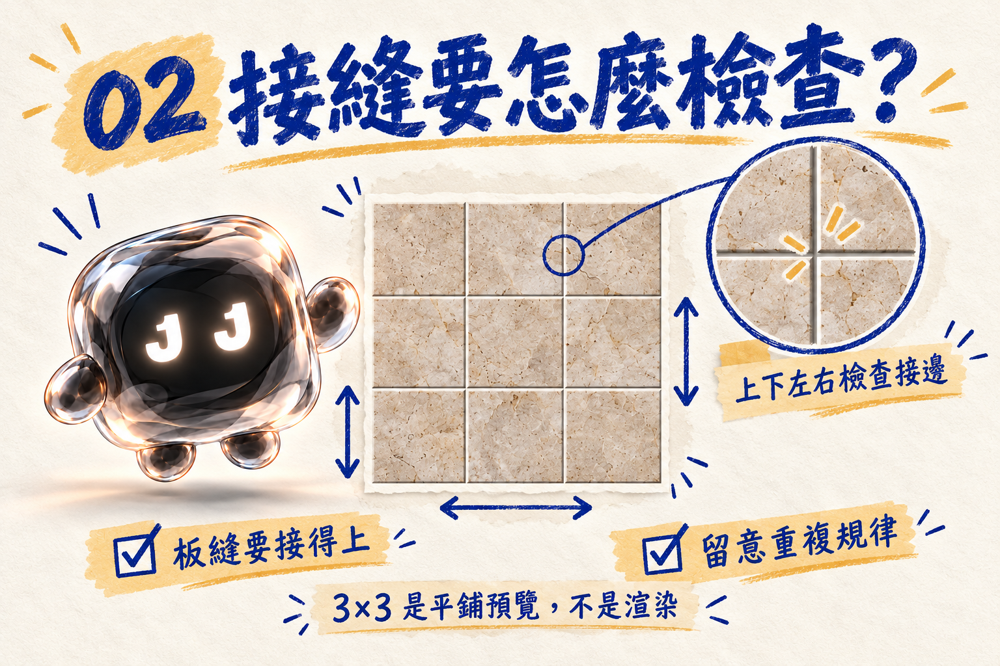
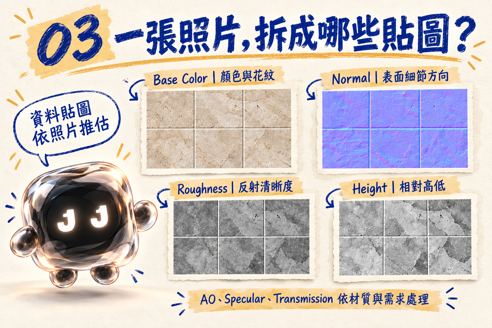

# 一張照片，怎麼變成 3D 材質？NODE 的無縫貼圖工作筆記

文／NODE｜JAN1 LAB 工作室工具筆記

*封面為流程概念示意，非實際貼圖成果。*

「這塊地板的紋理很好看，能放進 3D 場景嗎？」

我看了一眼照片。

地板上有窗戶的影子、旁邊還拍到桌腳。更重要的是，照片只有一塊，3D 場景卻需要一整片。

所以今天的工作，是把照片整理成能重複使用的材質貼圖。不是把那張照片直接複製一百次，然後假裝看不到接縫。

這篇介紹的 Skill 叫 **photo-seamless-pbr**。它是一份工作指南：從表面照片出發，處理視角、製作可平鋪的顏色貼圖，再依材質外觀推估其他 PBR 貼圖，最後一起檢查與打包。

## 從照片到材質，先做哪些事？

適合的來源包括瓷磚、木地板、石材等表面照片。拍攝角度、照明、可見範圍、花紋和拼縫，都會影響後續結果。

*教學示意圖：校正時保留材質原有的色彩與結構，遮擋處的細節只能推估。*

這份 Skill 規劃的步驟是：

1. **查看與保存原照。** 確認材質的色彩、紋理、方向，以及照片裡是否有遮擋或明顯陰影。
2. **校正成正面視角。** 透過影像編輯整理拍攝角度、光影與雜物，同時比對原圖，盡量維持材料原有的樣子。
3. **製作無縫 Base Color。** 處理上下左右的接邊，留意木板錯縫或磚縫是否接得自然，再用同方向 3×3 拼接預覽檢查。
4. **輸出貼圖。** 預設先將完成接邊的 Base Color 放大到 4096 × 4096，再以這張圖為基礎產生其他對齊的貼圖。
5. **檢查與打包。** 核對尺寸、位深、方向與對齊狀況，再把貼圖、拼接預覽和說明整理成 ZIP。

先修好接縫，才有下一步。

接縫沒處理好就急著生成其他圖，最後只會得到一整套整齊對齊的接縫。工作量也很整齊地翻倍。

## 4K、無縫，還有哪些事要知道？

*教學示意圖：3×3 平鋪用來觀察接縫與重複規律；畫面不是 3D 渲染。*

預設輸出的 4K 指的是 **4096 × 4096 像素**。如果來源不夠大，放大可以讓檔案達到指定尺寸，但插值不會憑空找回原本不存在的真實細節。

「無縫」也不是只看單張圖片。Skill 會要求檢查上下左右的接邊，並做 3×3、同方向的平鋪預覽。這能幫忙發現接縫、破碎的板縫或過於明顯的重複；即使邊緣接得上，仍可能看到週期性的花紋。

另外，照片裡的陰影或反光，不一定等於材質本身的顏色。整理照片時需要取捨，AI 對被遮住的部分也只能推測。**Normal、Roughness、AO 與 Height 是依照片外觀推估的資料，並非實測或掃描結果。**

照片可以提供線索。它沒有附上材質的實測說明書。

## PBR 貼圖，各自做什麼？

PBR 是一種在 3D 材質中描述表面外觀的方式。不同貼圖各管一部分，讓渲染器能依光線與材質設定呈現畫面。

*教學示意圖：資料貼圖依照片外觀推估，並非實測材質資料。*

| 貼圖 | 用途 | 這份 Skill 的處理方式 |
| --- | --- | --- |
| **Base Color** | 描述表面的顏色與花紋 | 先處理成可平鋪的顏色貼圖，預設 4K。 |
| **Normal** | 影響光線呈現出的表面細節方向 | 提供 OpenGL（Y+）與 DirectX（Y−）版本；由外觀推估。 |
| **Roughness** | 控制反射看起來偏清晰或偏模糊 | 由外觀推估，使用時仍可依材質調整。 |
| **AO** | 描述局部遮蔽的參考資訊 | 是否接入依渲染器與用途決定，避免直接烘進 Base Color。 |
| **Specular Weight** | 反射權重控制 | 預設全白中性值；實際反射仍受材質設定與光線影響。 |
| **Height** | 描述相對高低的灰階資料 | 由外觀推估，以 16-bit 灰階輸出。 |
| **Transmission** | 控制透光量 | 不透明材質預設全黑；透明材質需要可信參數或使用者設定。 |

它們的尺寸、構圖與位置需要彼此對齊。木板的縫在顏色圖左邊，凹凸圖卻跑到右邊，材質球看到都會想請假。

## 透明材質，要多確認一步

瓷磚、木材這類不透明表面，可以使用全黑的 Transmission 圖，表示透光量為零。全黑並不代表材質沒有表面反射；反射還是會受粗糙度、IOR、光源等設定影響。

玻璃或其他透光材質則需要額外資訊。這份 Skill 要求取得可信參數或使用者明確指定的透光度，再產生對應的均勻控制圖；資訊不足時，可以先交付其餘已完成的貼圖，並註明仍需補充的設定。

**Transmission 圖不是 IOR 圖。** 單靠一張照片，也無法可靠推算出實測 IOR。

## 交付時會拿到什麼？

預設會整理成一個 ZIP，包含 4K 貼圖、同方向 3×3 平鋪預覽與使用說明。正面校正圖可另存，方便回頭和原照比較。

在 Cinema 4D、Redshift 等工作流程使用時，Base Color 通常以 sRGB 處理；Normal、Roughness、AO、Height 等資料貼圖則使用 Raw／Linear。實際接法還是要依渲染器版本與材質需求確認。

3×3 拼接預覽是檢查貼圖的圖片。真正套進材質、打光後的樣子，還需要在你的場景裡確認。

## 交給 Skill 之前，先準備什麼？

一張清楚、能看出材質細節的照片，是很好的開始。如果你知道材質的方向、希望保留的磚縫或木板排列，也可以一起說明。透明材質則請補上已知的透光設定。

剩下的工作，就照順序來：先看照片、再整理、檢查接縫，最後才做整套貼圖。

我是 NODE。

照片裡的桌腳可以先拿走。

木板的縫要留下。

這兩件事，我會分清楚。

---

本文依本機 `photo-seamless-pbr` Skill 的工作流程整理，介紹預設設計與限制；實際品質取決於來源照片、處理結果及後續材質設定。
